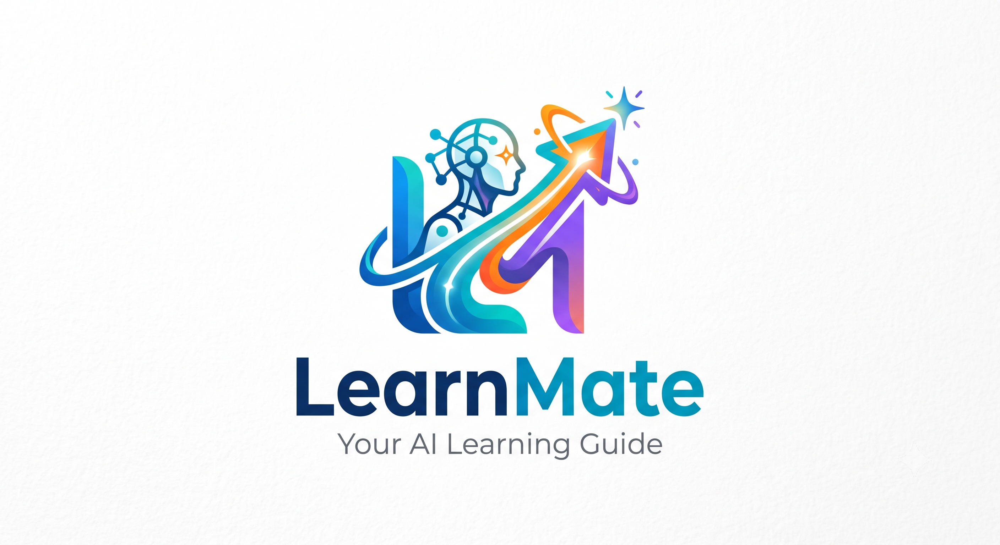

# LearnMate — Agentic AI Career & Learning Coach

> Powered by **IBM watsonx** · **Llama 3.3 70B Instruct** · Pure HTML/CSS/JS

LearnMate is a personalized AI learning coach that builds custom career roadmaps, recommends courses, projects, and certifications, and adapts continuously based on your progress.



---

## Features

- 🎯 **Personalized Roadmaps** — phased learning plans based on your goals and skill level
- 📚 **Course Recommendations** — IBM SkillsBuild, Coursera, freeCodeCamp, MDN & more
- 🏆 **Certification Guidance** — IBM, Google, AWS, Microsoft, Cisco
- 💡 **Project Ladder** — beginner → intermediate → advanced projects
- 📈 **Progress Tracking** — milestone checkboxes saved in your browser
- 🔄 **Adaptive Learning** — roadmap rebuilds when your goals change
- 💬 **Full Markdown Rendering** — tables, code blocks, headers, lists

---

## Quick Start

### 1. Clone the repo

```bash
git clone https://github.com/YOUR_USERNAME/learnmate-ui.git
cd learnmate-ui
```

### 2. Set up credentials

```bash
cp config.example.js config.js
```

Open `config.js` and fill in:

```js
IAM_TOKEN:  "Bearer <your_ibm_iam_token>",
PROJECT_ID: "<your_watsonx_project_id>",
```

**Get your IAM token** (expires every 1 hour):
```powershell
# PowerShell
$body = "grant_type=urn:ibm:params:oauth:grant-type:apikey&apikey=YOUR_API_KEY"
$res = Invoke-RestMethod -Method POST -Uri "https://iam.cloud.ibm.com/identity/token" -ContentType "application/x-www-form-urlencoded" -Body $body
Write-Host "Bearer $($res.access_token)"
```

**Get your Project ID:** [dataplatform.cloud.ibm.com](https://dataplatform.cloud.ibm.com) → Your Project → Manage → General

### 3. Open with Live Server

In VS Code: right-click `index.html` → **Open with Live Server**

Or:
```bash
npx serve .
```

---

## Project Structure

```
learnmate-ui/
├── assets/
│   └── LearnMate.png        # App logo
├── index.html               # UI shell
├── style.css                # Full dark theme
├── script.js                # Chat logic + API calls
├── config.js                # ⚠️ Your credentials (gitignored)
├── config.example.js        # Safe template to share
└── README.md
```

---

## IBM watsonx Configuration

| Setting | Value |
|---|---|
| Region | `au-syd` (Sydney) |
| Endpoint | `https://au-syd.ml.cloud.ibm.com/ml/v1/text/chat` |
| Model | `meta-llama/llama-3-3-70b-instruct` |

---

## Deployment

### GitHub Pages
1. Push this repo to GitHub
2. Go to **Settings → Pages**
3. Set source to `main` branch → `/` (root)
4. Your app will be live at `https://YOUR_USERNAME.github.io/learnmate-ui`

> ⚠️ Since `config.js` is gitignored, GitHub Pages visitors need to supply their own credentials. For a public demo, consider building a backend proxy.

---

## Tech Stack

- **Frontend:** HTML5, CSS3, Vanilla JavaScript
- **AI Model:** Llama 3.3 70B Instruct via IBM watsonx.ai
- **Markdown:** [marked.js](https://marked.js.org/)
- **Auth:** IBM Cloud IAM token

---

## License

MIT — built for IBM watsonx Hackathon / Demo purposes.
